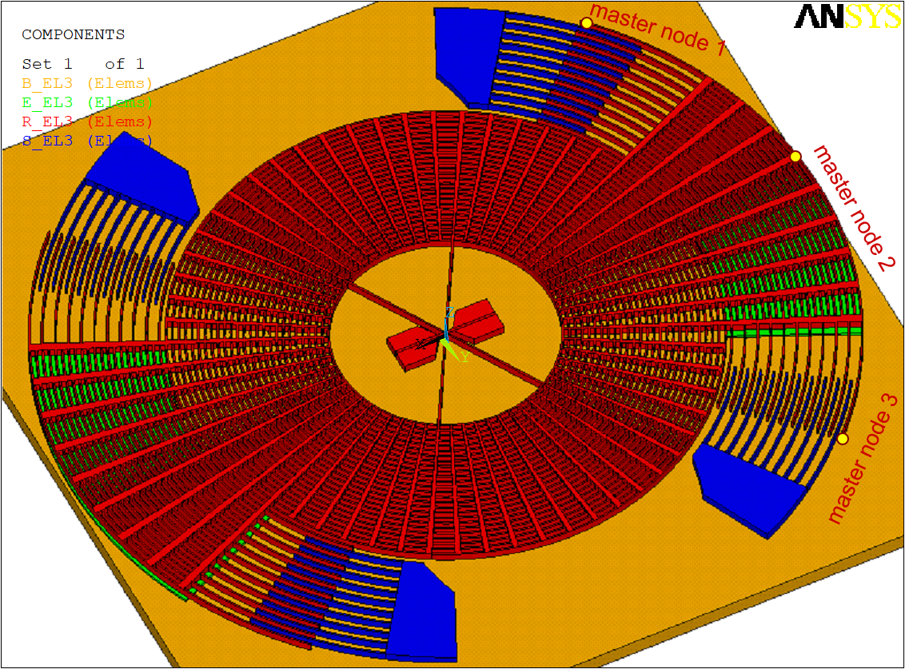

# vibration MEMS gyroscope

<!--

-->

## analytical model

## parameters of vibration MEMS gyroscope:

| generic parameter,  MKS unit              | TPU LL-gyro     |
|:------------------------------------------|:---------------:|
| sensitive mode:                           |                 |
| mass m, kg                                | 2.06e-7         |
| spring constant c, uN/um                  | 186.49          |
| Q factor                                  | 100             |
| drive mode:                               |                 |
| mass m, kg                                | 1.28e-7         |
| spring constant c, uN/um                  | 115.73          |
| Q factor                                  | 1000            |
|                                           |                 |
| plate area AZ, m2   | 1.42e-6         |
| initial gap hZ, m              | 45.0e-6         |
|                                           |                 |
| calculated parameter                      |                 |
| sensitive mode:                           |                 |
| resonance frequency fs, Hz     |   4592.2        |
| damping coefficient ds, uNs/um |  40.0e-3        |
| drive mode:                               |                 |
| resonance frequency fd, Hz     |   4791.4        |
| damping coefficient dd, uNs/um |                 |
| initial capacitance CZ, pF     |                 |

## RR-type

## LL-type

Barbin, E.S., Koleda, A.N., Nesterenko, T.G., Kolchuzhin, V.A.,
"Simulation of a micromechanical gyroscope at a system level",
Proceedings of the 20th Saint Petersburg International Conference on Integrated Navigation Systems, ICINS 2013 

# Reference:

D. Teegarden, G. Lorenz, R. Neul, How to model and simulate microgyroscope systems. 
IEEE Spectrum „Art & Technology“, July 1998 Vol. 35 No. 7, pp 66-75 

C. DÖRING, S. REITZ, J. BASTIAN, M. MAUTE, P. SCHNEIDER and P. SCHWARZ, 
”Verhaltensmodellierung eines Drehratensensors mittels Verfahren der Ordnungs-reduktion”, 
Proc. of 10. GMM-Workshop, 2004.

T. MÄHNE, K. KEHR, A. FRANKE, J. HAUER and B. SCHMIDT, 
“Creating Virtual Prototypes of Complex MEMS Transducers Using Reduced-Order Modelling Methods and VHDL-AMS”, 
Applications of Specification and Design Languages for SoCs: Selected papers from FDL'05, pp. 135-153, 2006.

Mehner, J. (2013) Modal-Superposition-Based Nonlinear Model Order Reduction for MEMS Gyroscopes, 
in System-Level Modeling of MEMS, Wiley-VCH Verlag GmbH & Co. KGaA, Weinheim, Germany. 
doi: 10.1002/9783527647132.ch12
